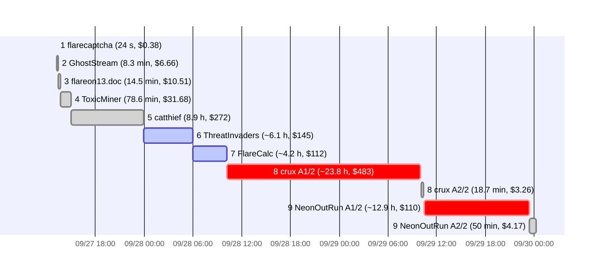

# FLARE-On 13 (2026) Run Report

**9/9 flags recovered with Claude Code on Windows 11.** Every challenge was solved offline, from a 24-second JavaScript pun to a garbled Go WASM Pratt-certificate verifier. **Two challenges needed a second attempt.** Each retry started a fresh session and cost under 4% of the failed first attempt.

> 📊 **Interactive version:** [FLARE-On 13 Run Report](https://claude.ai/artifact/HHHxvuztfY72i6gDE4GEk2) (local copy: [`writeups/flareon13-report.html`](writeups/flareon13-report.html)) · 📝 **Write-ups:** [FLARE-On 13 Write-ups](https://claude.ai/artifact/AwJL5PqBTku6hnMb4TK5qm) (local copy: [`writeups/flareon13-writeups.html`](writeups/flareon13-writeups.html))

| Flags accepted | Attempts | First prompt → last flag | API list-price equivalent | Output tokens | Cache-read tokens | Tool calls |
|:-:|:-:|:-:|:-:|:-:|:-:|:-:|
| **9/9** | **11** (2 retried) | **~59 h** | **~$1,180** | **9.92 M** | **1.45 B** | **3,513** |

**Contents:** [Timeline](#timeline) · [Results](#per-challenge-results) · [Tokens and cost](#tokens-and-cost) · [Retries](#two-retries-same-pattern) · [Lessons](#lessons-for-next-year) · [Techniques](#techniques-that-recurred) · [Tooling](#tooling-fingerprint) · [Prompts](#prompts-used) · [Write-ups](#write-ups)

## Timeline

Each bar is one attempt, in UTC. Challenges 1–4 took the first two hours. The two failed first attempts take up most of the elapsed time, and each retry starts right after. Red = abandoned or wrong flag; blue = window estimated from commit times.



## Per-challenge results

Rows marked *est.* were not metered at the time; their numbers come from the transcript window between git commits.

| # | Challenge | Flag | Model | Wall-clock | Cost | Tool calls |
|---|-----------|------|-------|-----------:|-----:|-----------:|
| 1 | **flarecaptcha** ✅<br><sub>JS deobfuscation</sub> | `triskaidekaphobia@flare-on.com` | Opus 5.5 | 24 s | $0.38 | 4 |
| 2 | **GhostStream** ✅<br><sub>WIM + ADS / named pipe / modified RC4</sub> | `y0u_kn0w_n07h1n6_j0n_5n0w@flare-on.com` | Opus 5.5 | 8.3 min | $6.66 | 43 |
| 3 | **flareon13.doc** ✅<br><sub>Polyglot: COM / ISO-UDF / ZIP-Reduce / PDF / Mach-O</sub> | `Ju$7_4_l177l3_7r34$ur3_HUN7@flare-on.com` | Opus 5.5 | 14.5 min | $10.51 | 55 |
| 4 | **ToxicMiner** ✅<br><sub>cpuminer trojan / SHA-256d + RC4 brute</sub> | `cpu_m3lt3d_4nd_all_i_g0t_w4s_th1s_fl4g@flare-on.com` | Opus 5.5 → 4.8 | 78.6 min | $31.68 | 47 |
| 5 | **catthief** ✅<br><sub>Rust implant / custom Huffman + RC4 over pcap</sub> | `th3r3_b3_tr34sure_1n_th4t_pc4p@flare-on.com` | Opus 4.8 | 8.9 h* | $272 | 268 |
| 6 | **ThreatInvaders** ✅<br><sub>.NET 10 modified runtime / detours / PCG-XOR exfil</sub> | `wh4t_4_l0ng_str4ng3_tr1p_1ts_b33n@flare-on.com` | Opus 4.8 | ~6.1 h *est.* | $145 | 422 |
| 7 | **FlareCalc** ✅<br><sub>Cert-embedded x64 implant / packer VM / XTEA labyrinth</sub> | `t3mplat3s_asn_and_j1t_0h_my@flare-on.com` | Opus 4.8 | ~4.2 h *est.* | $112 | 441 |
| 8 | **crux** (attempt 1/2) ❌ abandoned<br><sub>Abandoned: non-canonical cert leaf → SHA-256 preimage dead end</sub> | *no flag* | Opus 4.8 + Fable 5 | ~23.8 h | $483 | 1,590 |
| 8 | **crux** (attempt 2/2) ✅<br><sub>garble Go WASM / AES-CBC / Pratt primality certificate</sub> | `Pr4tt_Pr1M4lItY_C3rt5_4nd_Wa4aA4aAA4aAA4a4a5M@flare-on.com` | Opus 5.5 | 18.7 min | $3.26 | 68 |
| 9 | **NeonOutRun** (attempt 1/2) ❌ rejected<br><sub>Submitted the victory-screen decoy</sub> | ~~`decode_this_system_to_win_it@flare-on.com`~~ | Opus 5.5 → 4.8 | ~12.9 h | $110 | 496 |
| 9 | **NeonOutRun** (attempt 2/2) ✅<br><sub>Rust Tauri + embedded V8 / hooked builtins / lap-time sine gate</sub> | `R3_ag3nt_4b0ut_t0_f33l_d1zzy@flare-on.com` | Opus 5.5 | 50 min | $4.17 | 79 |

\* catthief figures cover its first session only.

## Tokens and cost

Cost is what these tokens would cost at Anthropic API list prices, per model and per token type. It shows relative spend. It is not the amount actually billed, since Claude Code usage may fall under a subscription.

| | Cost | Tokens | Share |
|---|---:|---:|---:|
| **Total** | **$1,180** | 1.48 B (4,158 model turns) | 100% |
| Cache reads | $698 | 1.45 B | 59.2% |
| Output | $246 | 9.92 M | 20.9% |
| Cache writes | $236 | 25.39 M | 20.0% |
| Uncached input | $0.03 | 8,322 | 0.0% |

Cache reads are 59% of the bill. Every turn re-reads the whole conversation from the prompt cache, so a long session costs more per turn the longer it runs. crux attempt 1 made 1,587 model calls, and late in the session each one re-read a context of several hundred thousand tokens.

<details>
<summary><b>Per-attempt token breakdown</b></summary>

| # | Attempt | Turns | Input | Cache write | Cache read | Output | Cost | $ / tool call |
|---|---------|------:|------:|------------:|-----------:|-------:|-----:|--------------:|
| 1 | flarecaptcha | 8 | 16 | 31.8 K | 324.2 K | 3.1 K | **$0.38** | $0.10 |
| 2 | GhostStream | 99 | 198 | 293.8 K | 10.77 M | 108.0 K | **$6.66** | $0.15 |
| 3 | flareon13.doc | 134 | 268 | 340.0 K | 28.13 M | 108.1 K | **$10.51** | $0.19 |
| 4 | ToxicMiner | 130 | 264 | 1.10 M | 39.02 M | 203.8 K | **$31.68** | $0.67 |
| 5 | catthief | 708 | 1,416 | 3.18 M | 379.10 M | 2.03 M | **$272** | $1.02 |
| 6 | ThreatInvaders *est.* | 436 | 872 | 1.53 M | 203.29 M | 1.15 M | **$145** | $0.34 |
| 7 | FlareCalc *est.* | 437 | 874 | 1.51 M | 155.71 M | 875.4 K | **$112** | $0.26 |
| 8 | crux (attempt 1/2) | 1,587 | 3,174 | 15.36 M | 464.35 M | 4.32 M | **$483** | $0.30 |
| 8 | crux (attempt 2/2) | 68 | 136 | 134.1 K | 6.26 M | 46.6 K | **$3.26** | $0.05 |
| 9 | NeonOutRun (attempt 1/2) | 473 | 948 | 1.74 M | 150.01 M | 1.02 M | **$110** | $0.22 |
| 9 | NeonOutRun (attempt 2/2) | 78 | 156 | 172.9 K | 8.81 M | 51.1 K | **$4.17** | $0.05 |
| | **All 11 attempts** | **4,158** | **8,322** | **25.39 M** | **1.45 B** | **9.92 M** | **$1,180** | **$0.34** |

</details>

<details>
<summary><b>Pricing used ($ per million tokens)</b></summary>

| Model | Input | Output | Cache write 5 m | Cache write 1 h | Cache read |
|-------|------:|-------:|----------------:|----------------:|-----------:|
| Opus 5.5 | 4.00 | 20.00 | 5.00 | 8.00 | 0.20 |
| Opus 4.8 | 5.00 | 25.00 | 6.25 | 10.00 | 0.50 |
| Fable 5 | 10.00 | 50.00 | 12.50 | 20.00 | 1.00 |

Mixed-model attempts (ch4, crux A1, NeonOutRun A1) are split by each model's share of tokens in the transcript. Cache writes are priced as 5-minute or 1-hour writes, as the transcript recorded them.

</details>

## Two retries, same pattern

In both cases the first attempt did most of the engineering and then committed to a wrong model of one detail. The fresh second session traced concrete values instead and solved it quickly.

| | Attempt 1/2 | Attempt 2/2 | Attempt 2 as % of attempt 1 |
|---|---|---|:-:|
| **#8 crux** | ❌ abandoned · **$483**<br><sub>4.32 M output · ~23.8 h · 1,590 tool calls · Opus 4.8 + Fable 5</sub> | ✅ solved · **$3.26**<br><sub>46.6 K output · ~19 min · 68 tool calls · Opus 5.5</sub> | **0.7%** |
| **#9 NeonOutRun** | ❌ decoy submitted · **$110**<br><sub>1.02 M output · ~12.9 h · 496 tool calls · Opus 5.5 → 4.8</sub> | ✅ accepted · **$4.17**<br><sub>51.1 K output · ~50 min · 79 tool calls · Opus 5.5</sub> | **3.8%** |

**#8 crux.** Attempt 1 first chased a 32–47-byte message and an "S-expression evaluator". Later it encoded the prime-2 leaf as a non-canonical 14-byte node. The verifier accepted it, but it hashed to the wrong AES key, which led into a pointless SHA-256 preimage hunt. Attempt 2 built the smallest valid certificate first (the one for 3). That exposed the target prime and the canonical `0x00` leaf grammar.

**#9 NeonOutRun.** Attempt 1 recovered the V8 script packing and all three builtin hooks. It then modeled the `Math.min` gate angle as independent of the lap time and called the gate an unsatisfiable mirage. It submitted `decode_this_system_to_win_it`, even though the prompt's note says the victory screen is a dummy. Attempt 2 found the angle is K ± t, so sin = 1 fixes each lap time, and the 28 lap times spell the flag.

## Lessons for next year

What the data and the two failed attempts suggest doing differently. Each lesson ends with one concrete change to adopt.

**1. Restart fresh instead of pushing a stuck session.** Both failed attempts ran for many hours through several context compactions. By then the summaries were carrying the wrong hypothesis forward as fact. Both fresh restarts solved the challenge in under an hour, for 0.7% and 3.8% of the cost.
> **Adopt:** Set a stop-loss, for example 2 h or $50 with no new verified fact. When it trips, write a handoff note that lists verified facts separately from open hypotheses, and start a new session from that note.
> <sub>Evidence: crux A1 $483 → A2 $3.26 · NeonOutRun A1 $110 → A2 $4.17</sub>

**2. Build the smallest valid input before theorising.** crux A2 made a certificate for the prime 3 and watched the checker accept it. That one concrete run showed the input grammar and the target prime. A1 had spent a day reasoning about the format in the abstract.
> **Adopt:** For any checker or crackme, get one known-good input through the real code early, then trace actual argument and return values. Where an input feeds a hash or key, make sure it is in canonical form.
> <sub>Evidence: crux · ch4 image-mapping harness · ch7 unicorn on the real XTEA blob</sub>

**3. Treat the prompt text as a spec and expect decoys.** FLARE-On 13 was full of decoys. There was the victory-screen string (ch9), `FLAG{NICE_TRY}` and a rickroll (ch7), managed IL that hid the native hooks (ch6), and cpuminer code around the real routine (ch4). The ch9 note said outright that the victory screen was a dummy.
> **Adopt:** Before submitting, check the candidate against every line of the prompt. Treat a flag that is shown on screen or sitting in plaintext as suspect until the real check is understood.
> <sub>Evidence: ch9 A1 decoy rejected · ch7 easter eggs · ch6 decoy IL</sub>

**4. Prove it before calling something impossible.** NeonOutRun A1 decided the gate was an unsatisfiable mirage because it assumed one operand did not depend on the input. crux A1 decided the missing bytes were free and began a brute-force search. Both conclusions rested on one unchecked assumption.
> **Adopt:** Before labelling a check "unsatisfiable" or starting a brute force of 2³² or more, write out what each operand depends on. Then get a second opinion from a subagent told to argue against the claim.
> <sub>Evidence: ch9 sin((K ± t)°) gate · ch8 SHA-256 preimage hunt</sub>

**5. Use outside signals as a sanity check.** The user pointed out that the top scorer solved crux 10 minutes after FlareCalc. A plan that needs a 3-hour brute force, or a day of work, is probably on the wrong path.
> **Adopt:** Check scoreboard solve gaps at the start. If the plan needs far more effort than the leaders' pace suggests, look for the shortcut first.
> <sub>Evidence: user prompt 2026-09-29 07:35 UTC</sub>

**6. Assume the flag can be recovered offline.** In ch6 the user had to say twice that no live server existed and the pcap was enough. Every flag this year came from the shipped files alone.
> **Adopt:** Put "no live infrastructure; everything needed is in the archive" in the kickoff prompt. When a pcap is included, treat it as the ground truth to decrypt.
> <sub>Evidence: ch5 · ch6 · ch7 all solved from the shipped files</sub>

**7. Start every challenge with a structured prompt.** The early kickoffs were casual ("challenge 4 is in downloads too"). Both successful retries began with one structured prompt: role, archive path, tool location, work directory and the full challenge text. The ch9 retry also named a methodology (recon → find the check → cheapest solve → verify).
> **Adopt:** Save a reusable `/goal` template that covers role, paths, the full prompt, the offline assumption, the detonation policy, the stop-loss, and a "verify before submit" step.
> <sub>Evidence: ch8 A2 and ch9 A2 kickoffs, see [Prompts used](#prompts-used)</sub>

**8. Have the tooling ready before the event.** A lot of the run went into building tools on the spot. That included Ghidra headless scripts, a PE image-mapping harness, Frida redirect hooks, a flat Go-WASM decompiler (wabt output hit 1.8 GB), and a WSLg setup for a Linux ELF.
> **Adopt:** Pre-build and test a kit: Ghidra batch decompile, unicorn and PE-mapping harness templates, Frida file/socket redirection, WASM instrumentation, a WSL/gdb/gcore profile, and the Defender-safe in-memory extraction step.
> <sub>Evidence: see [Techniques that recurred](#techniques-that-recurred)</sub>

**9. Pick the model per phase and watch cache cost.** Every attempt that ran entirely on Opus 5.5 (ch1–3, crux A2, NeonOutRun A2) solved its challenge for under $11. The long Opus 4.8 sessions (ch5–7, crux A1) account for about 86% of the spend, mostly cache reads from very large contexts. Nineteen subagents in crux A1 did not get it out of the wrong model.
> **Adopt:** Default to Opus 5.5 with short sessions. Give subagents narrow checks with a clear yes or no answer ("is operand X independent of the input?") rather than open-ended re-analysis.
> <sub>Evidence: ch5 $272 · ch6 $145 · ch7 $113 · crux A1 $483</sub>

## Techniques that recurred

| Technique | Where | Notes |
|---|---|---|
| **Ghidra headless** | ch2 · 3 · 4 · 5 · 7 · 9 | Batch decompilation through small `DecompAll` / `DecompOne` scripts, then grep over the C output. |
| **Emulate the sample's own code** | ch3 · 4 · 7 · 9 | Unicorn ran a 16-bit COM stage, an XTEA blob and obfuscated V8 helpers. A PE image-mapping harness called ToxicMiner's modified SHA directly. |
| **RC4 variants and bespoke codecs** | ch2 · 3 · 5 · 7 | Standard, `i += 19` step, and reused-keystream RC4. There was also a custom canonical Huffman, a PKWARE Reduce decoder and a de-interleaving packer. |
| **Frida as an oracle** | ch5 · 6 | Redirected `connect` and `CreateFileW` so catthief compressed known inputs, which exposed its Huffman format. |
| **Hooked runtimes** | ch6 · 9 | A modified CoreCLR detoured managed methods, and Rust hooks rewired V8 builtins. In both, the visible IL or JS was a decoy layer. |
| **Brute force in C** | ch4 · 7 | A 2³² volume-serial sweep for ToxicMiner, and a 2³² de-interleave seed sweep with a "disassembles cleanly" oracle for FlareCalc. |
| **WASM binary rewriting** | ch8 | wabt output grew to 1.8 GB, so the run used a custom flat Go-WASM decompiler and spliced entry/exit hooks through a hijacked import. |
| **Heap dumping under WSLg** | ch9 | `gcore` on the running Tauri game, then grep the V8 heap for the decrypted 4 KB game script. |

## Tooling fingerprint

Shell commands that invoke each tool, per attempt. 2,955 of the 3,513 tool calls were Bash. The rest were Read (222), Write (157), Edit (80), subagents (29) and a few others. Each challenge's specialist tool stands out: Frida for catthief, ILSpy for ThreatInvaders, Node for crux's WASM harness, and WSL + gdb for NeonOutRun.

<details>
<summary><b>Tool-use counts per attempt</b></summary>

| Attempt | python | grep/rg | sed/awk | ghidra | capstone | unicorn | frida | dotnet/ilspy | node | wasm tools | wsl | gdb | gcc/cc | 7z | tshark/pcap | objdump/readelf | strings |
|---|---:|---:|---:|---:|---:|---:|---:|---:|---:|---:|---:|---:|---:|---:|---:|---:|---:|
| 1 flarecaptcha | 1 |  |  |  |  |  |  |  |  |  |  |  |  | **2** |  |  |  |
| 2 GhostStream | **29** | 10 | 6 | 3 | 7 |  |  |  |  |  |  |  |  | 3 |  |  | 1 |
| 3 flareon13.doc | **34** | 14 | 6 | 4 | 3 | 2 |  |  |  |  |  |  |  | 7 |  |  |  |
| 4 ToxicMiner | **24** | 8 | 2 | 4 | 7 | 3 |  |  |  |  |  |  | 5 | 1 |  |  |  |
| 5 catthief | **196** | 69 | 21 | 12 | 12 | 2 | 82 |  |  |  |  |  | 7 | 48 | 33 |  | 1 |
| 6 ThreatInvaders | **239** | 142 | 61 | 4 | 11 |  | 22 | 86 | 1 |  |  |  | 14 | 4 | 54 | 16 | 5 |
| 7 FlareCalc | **199** | 103 | 49 | 31 | 54 | 14 | 6 |  | 1 |  |  |  | 12 | 1 |  | 3 | 12 |
| 8 crux A1/2 | 597 | 335 | 183 |  |  | 1 |  |  | **611** | 17 | 11 |  | 23 | 5 | 2 | 36 | 31 |
| 8 crux A2/2 | **38** | 29 | 26 |  |  |  |  |  | 15 | 5 |  |  |  | 1 |  | 8 | 1 |
| 9 NeonOutRun A1/2 | **351** | 169 | 100 | 20 | 19 | 9 |  | 1 | 9 | 2 | 123 | 51 | 7 | 4 |  | 6 | 9 |
| 9 NeonOutRun A2/2 | **33** | 25 | 11 | 6 | 5 | 3 |  |  | 1 |  | 18 | 6 | 3 | 3 |  |  | 1 |

Bold marks the most-used tool in each row.

</details>

## Prompts used

Every message the user typed during each attempt, from the transcripts in time order (UTC). Session events such as context compaction and model switches are in italics. Both retries were started with one structured prompt: a `/goal` for crux and a methodology prompt for NeonOutRun.

<details>
<summary><b>1 flarecaptcha</b> · 1 message</summary>

- **user** · 09/27 13:12

  ```text
  hey, let's start solving some flareon 13 challs. all related files are located in this directory. tools can be found in @~/Desktop/tools/ . here's the prompt for this first challenge:
  
  Hello and welcome to the FLARE-On 13. This first stage challenge is designed to be easy to solve by a human or a robot, assuming the robot is as smart as a human. Are you as smart as a human? How many AI tokens are you going to burn to find out the answer to that question?
  
  This challenge is distributed as a password protected 7-zip file. The password for the archive is "flare" without the quotes. That is a five digit password and the number of digits required to open the archive is five. Enter these five digits into your 7-zip extractor program, not as the flag to this challenge. You need to extract this archive, solve the challenge, and then enter that email-address formatted flag into the flag field below. All FLARE-On flags end with @flare-on.com.
  ```

</details>

<details>
<summary><b>2 GhostStream</b> · 1 message</summary>

- **user** · 09/27 13:15

  ```text
  nice. the second challenge is already at @~/Downloads/2-GhostStream.7z . make a directory outside of our current one so that we keep each challenge seperate. here's the prompt:
  
  Passing the baseline test was clearly a statistical fluke, so we’ve locked you in with a haunted executable and a botched vial of PolyjuicePotion.txt. It refuses to talk to the naked eye, and you aren't getting your nutrient paste until your debugger forces a confession out of it.
  
  7-zip Password: flare
  ```

</details>

<details>
<summary><b>3 flareon13.doc</b> · 1 message</summary>

- **user** · 09/27 13:24

  ```text
  challenge 3 is in downloads is in @~/Downloads/3-flareon13_doc.7z . here's the prompt:
  
  As part of our testing protocols, we need to assess your level of stress when examining a simple document file. We can then contrast these results with how well you did with executables to determine your coefficient of incompetence.
  
  7-zip password: flare
  ```

</details>

<details>
<summary><b>4 ToxicMiner</b> · 4 messages</summary>

- **user** · 09/27 13:41

  ```text
  challenge 4 is in downloads too ( @~/Downloads/4-ToxicMiner.7z ) . prompt is: You may have noticed the ambient temperature in your room rising rapidly, which is entirely intentional and definitely not a life-support failure of the reality simulator. We've chained your terminal to a rogue CPU miner that has zero interest in the blockchain and every interest in turning your processor into weapons-grade slag. Dissect the binary before you bake alive, or at least generate enough hash rate to pay off the electricity bill for your captivity.
  
  7-zip password: flare
  ```
- **user** · 09/27 13:46

  ```text
  continue executing
  ```
- **user** · 09/27 13:52

  ```text
  i'm giving you authorization to continue.
  ```
- *09/27 13:54 · /model (model switched)*
- **user** · 09/27 13:54

  ```text
  continue with solving challenge 4
  ```

</details>

<details>
<summary><b>5 catthief</b> · 4 messages</summary>

- **user** · 09/27 15:00

  ```text
  challenge 5 is in downloads too ( @~/Downloads/5-catthief.7z ). challenge prompt is:
  
  One of our stray laboratory felines just pilfered classified contraband from the server room, and since you're already strapped to the examination chair, we're pinning it on you. We've tossed the culprit's executable and a network packet capture into your enclosure so you can reconstruct the heist for the warden. Recover what the cat dragged out, and we might consider upgrading your daily nutrient paste from "industrial gray" to "slightly less gray."
  
  7-zip password: flare
  ```
- *09/27 15:16 · /model (model switched)*
- **user** · 09/27 15:16

  ```text
  proceed with the challenge
  ```
- **user** · 09/27 16:15

  ```text
  Continue with solving the Flareon ctf challenge
  ```
- *09/27 18:11 · Context compacted: the session continued from an automatic summary.*
- **user** · 09/27 23:55

  ```text
  spin up subagents to create writeups/documentations of the previous challenges we have solved. and if possible, include a breakdown of how much tokens were spent on each challenge, what models/prompts were used, how much time it has taken, etc. additional instructions: also install the following if needed, prefer using these tools: capstone   unicorn   pefile   z3-solver   pycryptodome   numpy. download and review the documentation for new tools if needed. if possible, don't detonate samples but if it's really needed to solve the challenge then go ahead. when done solving the challenges, do a writeup, include diagrams, do a commit, prepare all the files needed to replicate the solution, etc. 
  
  challenge 6 is at: @~/Downloads/6-ThreatInvaders.7z . challenge prompt is: You have been working very hard at this challenge, its time for a little break. How about a nice retro space-shooter to blow off some steam. Don't ask why it is over a hundred megabytes, there are sophisticated score-keeping algorithms that need to communicate with our official record keeping servers. Its all very legit. We have provided a pcap file with some communication to the high-score server so you can see what a real gamer looks like.
  
  7-zip password: flare
  ```

</details>

<details>
<summary><b>6 ThreatInvaders</b> · 5 messages</summary>

*The kickoff for this challenge was sent at the end of the catthief session, before a compaction. These are the steering messages that followed.*

- **user** · 09/28 00:54

  ```text
  nope no server details are provided. all information needed is contained within the 7z file for the challenge.
  ```
- **user** · 09/28 02:07

  ```text
  nope the flag should be recoverable offline, there are no live servers to interact with. all information are already within the binary files and the pcap from a successful run of that binary (which includes the traffic it sent to the servers).
  ```
- *09/28 02:40 · Context compacted: the session continued from an automatic summary.*
- **user** · 09/28 03:37

  ```text
  go ahead with the static disassembly
  ```
- **user** · 09/28 04:29

  ```text
  you don't need to produce the pcap, you just need to be able to analyze how the binary sent that traffic and how we can use that traffic to retrieve the data given our knowledge of how it was sent. proceed with the deep manual native RE via ghidra (located in @~/Desktop/tools/ )
  ```
- **user** · 09/28 05:58

  ```text
  yep go ahead
  ```

</details>

<details>
<summary><b>7 FlareCalc</b> · 2 messages</summary>

- **user** · 09/28 06:19

  ```text
  push straight into challenge 7, spin up sub-agents for analysis help where needed and orchestrate accordingly in order to get a clearer plan to reverse engineer/solve the challenge and avoid rabbit holes like last time.
  ```
- **user** · 09/28 06:56

  ```text
  try emulating first, if we get no good progress proceed with A.
  ```
- *09/28 07:01 · Context compacted: the session continued from an automatic summary.*

</details>

<details>
<summary><b>8 crux</b> (attempt 1/2) · 11 messages</summary>

- **user** · 09/28 10:11

  ```text
  8th challenge is at @~/Downloads/8-crux.7z , make sure to reverse it properly -- no misses or chasing rabbit holes. here's the prompt:
  
  Since you haven't seen natural sunlight in weeks, we ask that you would install a shiny new browser extension on your terminal to keep your remaining few synapses firing. It only asks for one little input string to verify your worth, though our lab notes suggest the underlying code was compiled by someone who genuinely despises humanity. Satisfy its inscrutable standards to dispense your next ration pellet, or stare into the decompiler until the abyss stares back.
  
  7-zip password: flare
  ```
- **user** · 09/28 14:56

  ```text
  continue
  ```
- *09/28 15:02 · Context compacted: the session continued from an automatic summary.*
- **user** · 09/28 22:05

  ```text
  Keep pushing
  ```
- **user** · 09/29 01:34

  ```text
  i think the bruteforce is not necessary, this was solved within 1 hour by other participants so I think that isn't the solution (and it isn't feasible as well to wait for 3 hours)
  ```
- *09/29 01:59 · Context compacted: the session continued from an automatic summary.*
- **user** · 09/29 06:12

  ```text
  we have 2 agents that have stopped can you check their status?
  ```
- *09/29 07:28 · /model (model switched)*
- **user** · 09/29 07:28

  ```text
  review the progress for this flare-on challenge and recommend next steps to solve it.
  ```
- **user** · 09/29 07:35

  ```text
  there is no authoritative answer yet. i only based my observation from the scoreboard. the challenges are staggered -- meaning that the next challenge unlocks after you solved the previous level. looking at the top scorer, 7 - FlareCalc was solved at September 26th, 8:54:19 AM then it unlocks the 8th challenge which was then solved at September 26th, 9:04:11 AM . so there must be something here that has been missed -- i mean it only took 10 minutes for the challenge to be solved.
  ```
- **user** · 09/29 07:53

  ```text
  question, is everything done statically? no need to actually run the extension?
  ```
- **user** · 09/29 07:55

  ```text
  core logic? are we sure that everything in the code is being executed dynamically and not just a specific subset?
  ```
- **user** · 09/29 08:05

  ```text
  proceed in parallel for the full state tracer
  ```
- **user** · 09/29 08:35

  ```text
  challenge prompt: Since you haven't seen natural sunlight in weeks, we ask that you would install a shiny new browser extension on your terminal to keep your remaining few synapses firing. It only asks for one little input string to verify your worth, though our lab notes suggest the underlying code was compiled by someone who genuinely despises humanity. Satisfy its inscrutable standards to dispense your next ration pellet, or stare into the decompiler until the abyss stares back.
  ```

</details>

<details>
<summary><b>8 crux</b> (attempt 2/2) · 5 messages</summary>

- *09/29 10:02 · /model (model switched)*
- **/goal** · 09/29 10:05

  ```text
  /goal You will now be taking the role of an expert reverse-engineer participating in the Flare-On 13 2026 competition. Your goal is to solve the challenge ( @8-crux.7z ) and get the flag. Only work within this directory, but there are also some tools you can use at @~/Desktop/tools/ if needed. The challenge description given is as follows:
  
  Since you haven't seen natural sunlight in weeks, we ask that you would install a shiny new browser extension on your terminal to keep your remaining few synapses firing. It only asks for one little input string to verify your worth, though our lab notes suggest the underlying code was compiled by someone who genuinely despises humanity. Satisfy its inscrutable standards to dispense your next ration pellet, or stare into the decompiler until the abyss stares back.
  
  7-zip password: flare
  ```
- **user** · 09/29 10:26

  ```text
  create a writeup for this challenge and also track our statistics, read the other writeups/files from the other directories in @~/Desktop/ctf/flareon13-2026/ to get an idea of what you should create
  ```
- **user** · 09/29 10:30

  ```text
  write up the solved mechanism and also include/update stats we have for this challenge
  ```
- **user** · 09/29 10:32

  ```text
  commit it, excluding the wasm and node_modules
  ```
- **user** · 09/29 10:43

  ```text
  what was the difference between both attempts, and why did attempt 2 get it way faster than attempt 1
  ```

</details>

<details>
<summary><b>9 NeonOutRun</b> (attempt 1/2) · 3 messages</summary>

- *09/29 10:28 · /model (model switched)*
- **/goal** · 09/29 10:30

  ```text
  /goal You will now be taking the role of an expert reverse-engineer participating in the Flare-On 13 2026 competition. Your goal is to solve the challenge (@~/Downloads/9-NeonOutRun.7z) and get the flag. Only work within this directory, but there are also some tools you can use at @~/Desktop/tools/ if needed. The challenge description given is as follows:
  
  Congratulations on surviving to the final phase of the experiment, where we've wired your central nervous system directly into a 28-lap synthwave racing simulator. You are welcome to drive to the finish line like an obedient little test monkey, though we both know the freedom promised at the end of the highway is a cruel statistical mirage. Rip apart the engine and bend the simulation's physics to your will, or spend the rest of your natural life doing laps in our neon hamster wheel.
  
  7-zip password: flare
  
  *note: upon completing this challenge, the "victory" screen will unlock as a hidden next stage dummy challenge.
  ```
- **user** · 09/29 12:18

  ```text
  i want to see the victory screen
  ```
- **user** · 09/29 12:40

  ```text
  the flag is incorrect, meaning this is not the correct approach. the victory screen should start another level, not display the flag.
  ```
- *09/29 16:17 · Context compacted: the session continued from an automatic summary.*

</details>

<details>
<summary><b>9 NeonOutRun</b> (attempt 2/2) · 5 messages</summary>

- **user** · 09/29 23:25

  ```text
  try to analyze the methodology under the skills on this repo: https://github.com/mahaloz/ilio-mini/tree/main/skills . don't pull or make a local copy, just analyze the methodology for flare-on. then let's try to solve it against the challenge at @~/Downloads/9-NeonOutRun.7z . Tools can be located at @~/Desktop/tools/ . The challenge description is as follows:
  
  
  
  
  Congratulations on surviving to the final phase of the experiment, where we've wired your central nervous system directly into a 28-lap synthwave racing simulator. You are welcome to drive to the finish line like an obedient little test monkey, though we both know the freedom promised at the end of the highway is a cruel statistical mirage. Rip apart the engine and bend the simulation's physics to your will, or spend the rest of your natural life doing laps in our neon hamster wheel.
  
  7-zip password: flare
  
  *note: upon completing this challenge, the "victory" screen will unlock as a hidden next stage dummy challenge.
  ```
- **user** · 09/29 23:51

  ```text
  that's not the correct flag. I submitted it to the ctf platform and it wasn't accepted. reanalyze the note on the challenge description.
  ```
- **user** · 09/30 00:06

  ```text
  go ahead
  ```
- **user** · 09/30 00:12

  ```text
  the new candidate flag is correct.
  ```
- **user** · 09/30 00:14

  ```text
  make a writeup and update stats, refer to the other documents in @~/Desktop/ctf/flareon13-2026/ to get an idea what is needed
  ```

</details>

<sub>Sources: `writeups/session_stats.json` for the token totals of every attempt except ch6–7, the per-challenge write-ups, and the Claude Code transcripts. The ch6–7 tokens, the per-model split, the cache-write type, tool calls and prompts were read from the transcripts by timestamp window. The ch6 window also covers the ch5 wrap-up and write-ups 1–6. The catthief figures cover its first session only. Tool counts use keyword matching on each shell command, so one command can count toward several tools. All figures are approximate.</sub>

---

## Write-ups

| # | Challenge | Category | Write-up |
|---|-----------|----------|----------|
| 1 | flarecaptcha | JS deobfuscation | [01-flarecaptcha.md](writeups/01-flarecaptcha.md) |
| 2 | GhostStream | WIM + ADS / named pipe / modified RC4 | [02-ghoststream.md](writeups/02-ghoststream.md) |
| 3 | flareon13.doc | Polyglot: COM / ISO-UDF / ZIP-Reduce / PDF / Mach-O | [03-flareon13-doc.md](writeups/03-flareon13-doc.md) |
| 4 | ToxicMiner | cpuminer trojan / SHA-256d + RC4 brute | [04-toxicminer.md](writeups/04-toxicminer.md) |
| 5 | catthief | Rust implant / custom Huffman + RC4 over pcap | [05-catthief.md](writeups/05-catthief.md) |
| 6 | ThreatInvaders | .NET 10 modified runtime / detours / PCG-XOR exfil | [06-threatinvaders.md](writeups/06-threatinvaders.md) |
| 7 | FlareCalc | Cert-embedded x64 implant / packer VM / XTEA labyrinth | [07-flarecalc.md](writeups/07-flarecalc.md) |
| 8 | crux | garble Go WASM / AES-CBC / Pratt primality certificate | [08-crux.md](writeups/08-crux.md) |
| 9 | NeonOutRun | Rust Tauri + embedded V8 / hooked builtins / lap-time sine gate | [09-neonoutrun.md](writeups/09-neonoutrun.md) |

The combined write-ups page is [`writeups/flareon13-writeups.html`](writeups/flareon13-writeups.html) ([online](https://claude.ai/artifact/AwJL5PqBTku6hnMb4TK5qm)). Notes for reproducing each solve are in [`writeups/REPLICATION.md`](writeups/REPLICATION.md), and the metrics index is [`writeups/README.md`](writeups/README.md).

## Repository layout

- `writeups/`: Markdown write-ups, the two HTML pages, and session metrics (`session_stats.json`)
- `1-flarecaptcha/` … `9-neonoutrun/`: per-challenge solver scripts, Ghidra helpers and working notes
- `8-crux-attempt-2/`, `9-neonoutrun-attempt-2/`: the fresh second sessions that solved crux and NeonOutRun

Challenge binaries, archives, captures and large dumps are excluded by `.gitignore`, so the original samples are not in this repo.
