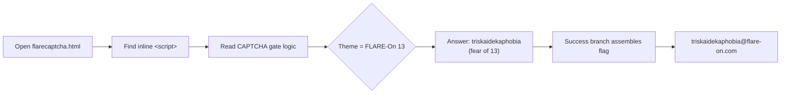

# FLARE-On 13 — Challenge 1: flarecaptcha

| | |
|---|---|
| **Challenge** | flarecaptcha |
| **Artifact** | `flarecaptcha.html` (self-contained HTML + JavaScript) |
| **Category** | Web / JavaScript deobfuscation |
| **Flag** | `triskaidekaphobia@flare-on.com` |

## Prompt (paraphrased)
A warm-up "prove you're human" CAPTCHA page. Solve the CAPTCHA correctly and the page reveals the flag. (FLARE-On always opens with an easy confidence-builder.)

## Files provided
- `flarecaptcha.html` — a single HTML document with an inline `<script>` implementing the CAPTCHA logic and the flag-gating check.

## Tools used
- A text editor / browser devtools
- Manual JavaScript reading (no heavy tooling required)

## Methodology

1. **Triage.** Opened the HTML and located the inline `<script>`. The page presents a CAPTCHA-style prompt; the "success" branch computes/derives the flag rather than shipping it in cleartext.
2. **Read the logic.** The gating check keys off the theme of the competition — **FLARE-On *13***. The intended answer is the word for *fear of the number 13*: **triskaidekaphobia**.
3. **Recover.** Supplying the expected value drives the success branch, which assembles the flag string `triskaidekaphobia@flare-on.com`.

This challenge is a themed pun rather than a reversing problem — the "13" motif of the whole event is baked into the very first puzzle.

## Solve flow

## Session stats
| Metric | Value |
|---|---|
| Model | Claude Opus 5.5 |
| Assistant turns (with usage) | 8 |
| Output tokens | 3,080 |
| Cache-read tokens | 324,235 |
| Wall-clock | ~24 seconds |

*(Approximate, measured from the Claude Code transcript.)*
