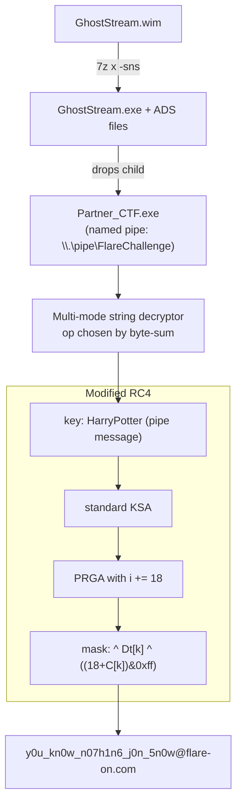

# FLARE-On 13 — Challenge 2: GhostStream

| | |
|---|---|
| **Challenge** | GhostStream |
| **Artifact** | `GhostStream.wim` (Windows Imaging Format archive) |
| **Category** | Windows RE / IPC / modified stream cipher |
| **Flag** | `y0u_kn0w_n07h1n6_j0n_5n0w@flare-on.com` |

## Prompt (paraphrased)
A "ghost" that streams data between two processes. Recover the flag it whispers over its private channel.

## Files provided
- `GhostStream.wim` — a WIM image. Contains the parent executable (`GhostStream.exe`), supporting data, and (importantly) content in **alternate data streams** that a naive extraction misses.

## Tools used
- **7-Zip** with `-sns` (extract NTFS alternate data streams from the WIM)
- **Ghidra** (headless decompile) for the parent/child logic
- **Python** (`_winapi`) to sniff the named pipe dynamically (`sniff.py`)
- Custom Python to model the string decryptor (`dec.py`) and the modified RC4 (`solve.py`, `brute.py`)
- A patched child binary (`child_patched.exe`) for controlled execution

## Methodology

### 1. Extract the WIM (including ADS)
The WIM hides data in alternate data streams; extracting with `7z x -sns` surfaces the extra files (e.g. `PolyjuicePotion.txt`) alongside `GhostStream.exe`.

### 2. Understand the architecture
`GhostStream.exe` (the **parent**) drops a **child** (`Partner_CTF.exe`) into `%TEMP%` and talks to it over a named pipe: `\\.\pipe\FlareChallenge`. The flag is transmitted across this channel.

- To observe it live without fully trusting the sample, `sniff.py` pre-creates a lock on the child drop path, launches the parent with a redirected `TEMP`, then opens the pipe itself and reads the message.

### 3. Beat the obfuscation
Strings are encrypted with a **sum-selected multi-mode** scheme — the decryptor picks an operation (`-k`, `(+1)^k`, `-2+k`, …) based on the byte-sum of each blob and a key byte derived from the module name (`dec.py` reproduces the exact table).

### 4. The cipher: a *modified* RC4
The flag emitter is RC4 with a twist (`solve.py`):
- **KSA**: standard `j = j + key[i%len] + S[i]`.
- **PRGA**: the index step is **`i += 18`** (not `+1`), and each keystream byte is additionally masked:
  `out[k] = S[(S[i]+S[j])&0xff] ^ Dt[k] ^ ((18 + C[k]) & 0xff)`
  where `Dt` is a string run through a *patched* `strlen`-style transform (`s[i] = ((s[i]+i+1)&0xff) ^ 0x13`) and `C` is a fixed 38-byte blob embedded in the child.

### 5. Recover the key & flag
The key material is themed: the parent reads `AlbusDumbledore` from the ADS `PolyjuicePotion.txt:LordVoldemort` and transforms it before sending it to the child. Enumerating static candidates (potion text, window-create message variants, `AlbusDumbledore ` with/without trailing space) didn't hit. Running the patched parent under `sniff.py` showed the pipe message is `HarryPotter`. Keying the modified PRGA with it, with step `L ∈ {18,19}` and mask `Dt`, gave the flag at `L = 18` (`flag.py`):

```
y0u_kn0w_n07h1n6_j0n_5n0w@flare-on.com
```

## Cipher pipeline



## Session stats
| Metric | Value |
|---|---|
| Model | Claude Opus 5.5 |
| Assistant turns (with usage) | 99 |
| Output tokens | 107,968 |
| Cache-read tokens | 10,771,008 |
| Wall-clock | ~8.3 minutes |

*(Approximate, measured from the Claude Code transcript.)*
