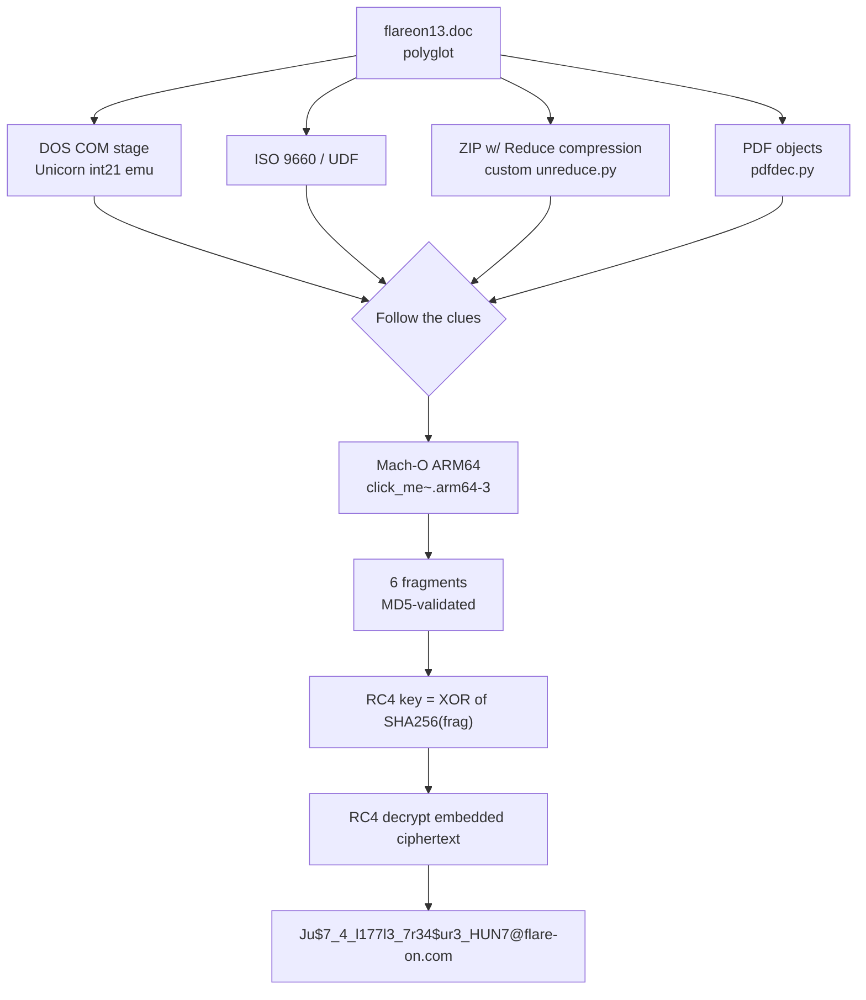

# FLARE-On 13 — Challenge 3: flareon13.doc (polyglot treasure hunt)

| | |
|---|---|
| **Challenge** | flareon13.doc |
| **Artifact** | `flareon13.doc` — a multi-format **polyglot** |
| **Category** | Polyglot / multi-stage RE (DOS COM, ISO/UDF, ZIP-Reduce, PDF, Mach-O ARM64) |
| **Flag** | `Ju$7_4_l177l3_7r34$ur3_HUN7@flare-on.com` |

## Prompt (paraphrased)
A Word document that is far more than it appears. Follow the trail of file formats to the treasure.

## Files provided
- `flareon13.doc` — the polyglot. Simultaneously a DOS **COM** program, a Word doc, an **ISO/UDF** image, a **ZIP** (using the obsolete *Reduce* compression), a **PDF**, and a carrier for a **Mach-O ARM64** binary.

Working files carved during the solve: `cd.iso`, `udf`, `layer.zip` / `layer_zip`, `macho/click_me~.arm64-3`, `img0.png`, `page_small.png`, `obj*.bin`, plus emulators/decoders.

## Tools used
- **Unicorn Engine** (`com_emu.py`, `small_emu.py`) to emulate the 16-bit DOS COM stage (int 21h)
- Custom **PKWARE Reduce** decompressor (`unreduce.py`, `zipr.py`) — Python's `zlib` cannot handle Reduce
- **PDF** object extraction/decoder (`pdfdec.py`)
- ISO 9660 / **UDF** parsing (`udf`)
- Mach-O parsing + **hashlib** (MD5/SHA-256) + RC4 (`final.py`)

## Methodology

This challenge is a nested "treasure hunt" — each format is a layer pointing at the next.

### 1. DOS COM stage
`flareon13.doc` begins with runnable 16-bit code. Emulating it in Unicorn (`UC_MODE_16`, load at `0x100`, hook `int 0x21` for AH=09h/02h output) prints the first clue and reveals how the file doubles as other formats.

### 2. Polyglot container layers
The same bytes parse as:
- an **ISO 9660 / UDF** optical image (`cd.iso`, `udf`) — tagged descriptors carry a stage,
- a **ZIP** archive whose entries use **Reduce** compression (method not supported by modern tooling → hand-rolled `unreduce.py`),
- a **PDF** (objects extracted/decrypted in `pdfdec.py`, images `img0.png` / `page_small.png`).

Following these produces the final payload: a **Mach-O ARM64** executable (`macho/click_me~.arm64-3`).

### 3. Final crypto in the Mach-O
The Mach-O embeds six themed string fragments, each **validated by an MD5** stored (as nibble-packed bytes) in the binary:

```
FLARE-STANDARD-ANTIVIRUS-TEST-FILE!   (EICAR nod)
mainframe_ebcdic_ghost
jbig2_fax_geometry
udf_tagged_descriptor
reduce_not_deflate
Ød1n_373rn4l_fl4r3                    (Odin / "eternal flare")
```

The RC4 **key = XOR of SHA-256(fragment) over all six fragments** (32 bytes). The S-box seed is the identity permutation; a standard RC4 KSA/PRGA then decrypts the embedded ciphertext:

```python
key = bytearray(32)
for f in frags:
    for i,c in enumerate(hashlib.sha256(f.encode()).digest()):
        key[i] ^= c
# standard RC4 KSA over identity S, PRGA, XOR ciphertext -> flag
```

Result:

```
Ju$7_4_l177l3_7r34$ur3_HUN7@flare-on.com
```

The flag itself ("Just a little treasure hunt") is the punchline of the layered format chase.

## Layer chain



## Session stats
| Metric | Value |
|---|---|
| Model | Claude Opus 5.5 |
| Assistant turns (with usage) | 134 |
| Output tokens | 108,133 |
| Cache-read tokens | 28,134,581 |
| Wall-clock | ~14.5 minutes |

*(Approximate, measured from the Claude Code transcript.)*
