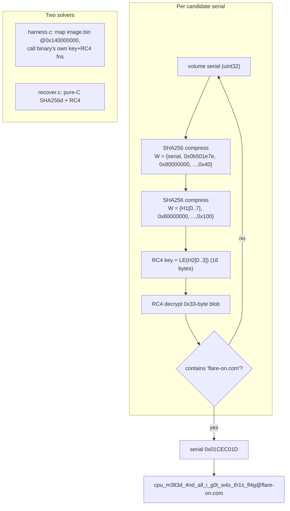

# FLARE-On 13 — Challenge 4: ToxicMiner

| | |
|---|---|
| **Challenge** | ToxicMiner |
| **Artifact** | `ToxicMiner.exe` (x86-64 PE, based on **cpuminer-multi**) |
| **Category** | Windows RE / keyed crypto / brute force |
| **Flag** | `cpu_m3lt3d_4nd_all_i_g0t_w4s_th1s_fl4g@flare-on.com` |

## Prompt (paraphrased)
A cryptominer that "melted your CPU" — recover what it was really computing. The flag is gated on your machine's identity.

## Files provided
- `ToxicMiner.exe` — a trojanized `cpuminer-multi` build. The mining code is a decoy; a hidden routine derives a key from the host and prints `Accepted: <flag>` only on the intended machine.

Working files: `image.bin` (the PE mapped image), `harness.c`/`harness.exe` (brute-force harness), `emu_key.py` / `emu_comp.py`, `h_*.txt` / `hit_*.txt` (brute-force shards), `recover.c` (pure-C reimplementation).

## Tools used
- **Ghidra** (headless) to locate the key-derivation (`FUN_140134ca0`) and RC4 (`FUN_140134d70`)
- **pefile** to produce a flat mapped image (`image.bin`)
- **Image-mapping harness** (`harness.c`): `VirtualAlloc` the PE at its preferred base `0x140000000` with `PAGE_EXECUTE_READWRITE`, then **call the binary's own functions directly** as function pointers — guaranteeing byte-exact (modified) SHA behavior without re-implementing it
- A parallel pure-C reimplementation (`recover.c`) for cross-checking and speed

## Methodology

### 1. Cut through the cpuminer noise
The bulk of the binary is legitimate `cpuminer-multi`. Static triage isolated a non-mining routine that reads the **C: volume serial number** and uses it as a seed.

### 2. The key derivation — a word-oriented SHA-256d
The key is a **double SHA-256** (SHA-256d) implemented over `uint32` word arrays (no input byte-swap), seeded by the volume serial and a magic constant `0x0b501e7e`:

```
round1 W = { serial, 0x0b501e7e, 0x80000000, 0..., 0x40  }
H1 = SHA256_compress(IV, round1 W)
round2 W = { H1[0..7], 0x80000000, 0..., 0x100 }
H2 = SHA256_compress(IV, round2 W)
key = little-endian bytes of H2[0..3]        # 16-byte RC4 key
```

RC4 then decrypts a **0x33-byte** blob; the plaintext is `Accepted: <flag>`.

### 3. Brute-force the volume serial (2^32)
A volume serial is a 32-bit value, so the whole space is brute-forceable. Two independent solvers were run and cross-checked:

- **`recover.c`** — a from-scratch SHA-256d + RC4 in C, scanning serial ranges for a plaintext containing `flare-on.com`.
- **`harness.c`** — maps `image.bin` at `0x140000000` and calls **the binary's own** `FUN_140134ca0` (key) and `FUN_140134d70` (RC4), so even a *modified* SHA is reproduced exactly. Work was sharded (`h_*.txt` / `hit_*.txt`) across ranges.

The winning **volume serial = `0x01CEC01D`** (a cheeky "ICE COLD" / "01CEC01D") yields:

```
cpu_m3lt3d_4nd_all_i_g0t_w4s_th1s_fl4g@flare-on.com
```

## Key-derivation & brute pipeline



## Notes / dead-ends
- Re-implementing the SHA from the decompiler was error-prone (word ordering, no byte-swap); the **image-mapping harness** sidestepped that entirely by calling the sample's own code.
- This challenge is where we switched between **Opus 5.5** and **Opus 4.8** mid-solve (see stats).

## Session stats
| Metric | Value |
|---|---|
| Models | Claude Opus 5.5 (39 turns) + Opus 4.8 (91 turns) |
| Assistant turns (with usage) | 130 |
| Output tokens | 203,806 |
| Cache-read tokens | 39,017,330 |
| Wall-clock | ~78.6 minutes |

*(Approximate, measured from the Claude Code transcript.)*
