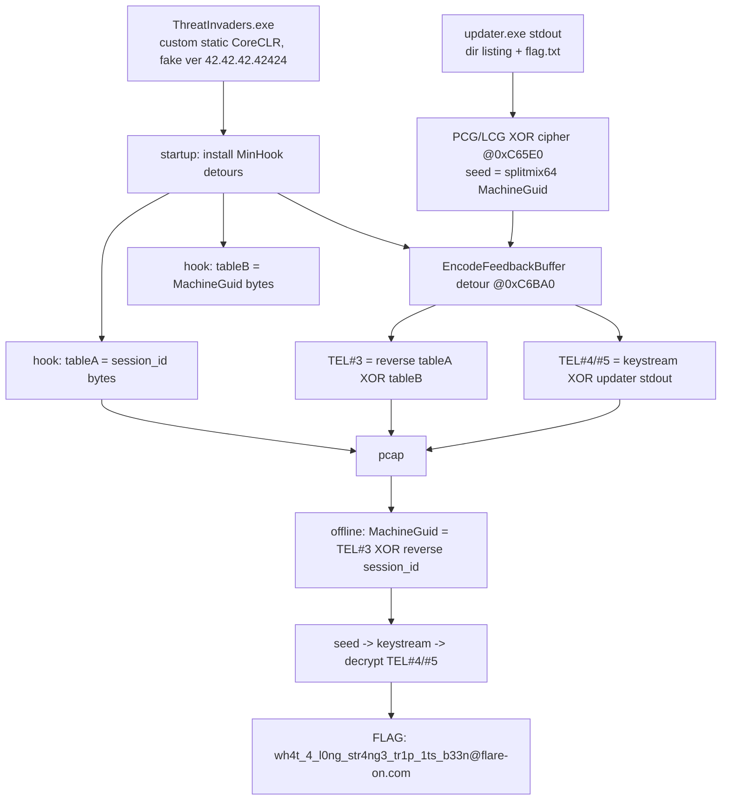

# FLARE-On 13 — Challenge 6: ThreatInvaders

**Status:** ✅ Solved — flag recovered **fully offline** from `challenge.pcapng`.

**Flag:** `wh4t_4_l0ng_str4ng3_tr1p_1ts_b33n@flare-on.com`

## Prompt
> How about a nice retro space-shooter to blow off some steam. Don't ask why it is over a hundred megabytes, there are sophisticated score-keeping algorithms that need to communicate with our official record keeping servers. Its all very legit. We have provided a pcap file with some communication to the high-score server so you can see what a real gamer looks like.

## Files
- `ThreatInvaders.exe` — 116 MB **.NET 10 self-contained single-file** WinForms *Space Invaders*. PDB path: `Z:\CTFs\FlareOn\SpaceInvaders\space-invaders\src\SpaceInvaders\...\ThreatInvaders.pdb`.
- `challenge.pcapng` — 966 packets, one TCP/80 conversation (`192.168.198.129` ↔ mock `192.168.198.130`, `Server: MockHighscore/1.0`).

## TL;DR
The game's **managed code is a faithful decoy**. The exe ships a **modified .NET runtime** (a custom‑built CoreCLR statically linked into the apphost, reporting a fake version `42.42.42.42424`). At startup it installs **MinHook‑style detours** on a handful of managed methods. The `EncodeFeedbackBuffer` detour secretly exfiltrates the stdout of a local `updater.exe` through the telemetry `feedback_b64` field, **XOR‑encrypted with a PCG/LCG keystream** whose seed is the machine's `MachineGuid`. Because the covert `feedback_length` and a 16‑byte header (`TEL#3`) leak enough state, the whole thing is decryptable **from the pcap alone**.

## Triage
The 116 MB is a .NET single‑file bundle: PE sections ≈ 15 MB, the rest is the embedded runtime + assemblies (bundle signature `8b 12 02 b9 …`). Extracting `ThreatInvaders.dll` (100 KB) and decompiling (ICSharpCode.Decompiler 11.1) yields a normal Space Invaders plus a REST high‑score client.

## The telemetry (managed view — the decoy)
`TelemetryReporter.BuildDocument` builds `{request_id, session_id, games_played, client_version, feedback_b64, feedback_length}` where:
```csharp
length      = Math.Min(feedback.Length, 4096);   // capped at 4096
Array.Copy(feedback, buf4096, length);
feedbackB64 = EncodeFeedbackBuffer(buf4096, ref length); // Base64(buf), never edits length
FeedbackLength = length;                          // <= 4096
```
The raw IL (verified with `ilspycmd -il`) matches exactly. **Yet the pcap shows `feedback_length` = 0, 0, 8208, 16914, 16430** and high‑entropy `feedback_b64` content — impossible under this IL.

**Ground‑truth pcap telemetry** (note: the telemetry POSTs are LSO/GRO frames with IP total‑length = 0, so reassembly must read to the end of the captured frame, not `ip.len`):

| beacon | feedback_length | content (Base64‑decoded, nonzero prefix) |
|---|---|---|
| TEL#1 | 0 | empty |
| TEL#2 | 0 | `Crashes sometimes. But overall very fun…` (plaintext user feedback) |
| TEL#3 | 8208 | 16 bytes (header) |
| TEL#4 | 16914 | 530 bytes (encrypted) |
| TEL#5 | 16430 | 46 bytes (encrypted — flag‑sized) |

## Proving it's native
- The extracted game IL is faithful (BuildDocument, EncodeFeedbackBuffer, Math.Min all verified via **live JIT dumps**).
- **Every managed runtime assembly** in the bundle (`System.Private.CoreLib.dll`, `System.Text.Json.dll`, …) is **byte‑identical** to stock .NET 10.0.11 → nothing modified in managed land.
- The native CoreCLR is a **custom build** (only ~8 % of 16‑byte code slices match stock) → the modification is native.

## Finding the modification (native RE)
Static diffing was hopeless (custom build). Instead:
1. **EventPipe rundown** (custom `eptrace` tool) → native code addresses of all JIT'd methods; `ReadProcessMemory` to dump them. Confirmed BuildDocument/EncodeFeedbackBuffer/Math.Min are faithful.
2. Resolved the actual `EncodeFeedbackBuffer` call target from BuildDocument's JIT'd code → it lands **not** on the real method but on an **injected function at RVA `0xC6BA0`** inside the exe's `.text`.
3. A hook‑installer at RVA `0xC6E30` wires several detours (`0xC6BA0`, `0xC6A70`, `0xC6DF0`, `0xF54E0`, …) — a MinHook‑style framework.
4. **Frida** hooks on the cipher confirmed the data flow live.

### The injected pieces
- `0xC65E0` — **stream cipher**: `seed = splitmix64‑variant(tableB)`, then an LCG keystream
  `state = state*0x5851f42d4c957f2d + 0x14057b7ef767814f`, output byte = `state >> 56`, XORed into the buffer. Symmetric.
- `0xC6A70` — captures a hooked method's result (the **updater stdout**), copies it into a static buffer, and calls `0xC65E0` to encrypt it in place.
- `0xC6DF0` → `tableA` (RVA `0x7FF800`) = **`session_id.ToByteArray()`**.
- `0xF54E0` → `tableB` (RVA `0x7FFA30`) = **`MachineGuid.ToByteArray()`**.
- `0xC6BA0` — the `EncodeFeedbackBuffer` detour / state machine that emits the beacons:
  - **first exfil (TEL#3):** writes 16 bytes = `reverse(tableA) ^ tableB`, sets length global `0x2010` (8208).
  - **subsequent (TEL#4/#5):** streams the encrypted updater output, length `|= 0x4000` → `0x4212`/`0x402E`.
- Anti‑analysis: content exfil is gated by a byte at RVA `0x7FD5FE` (unset in a sandbox → content stays zero, only the length leaks).

## The offline decryption
`TEL#3 = reverse(session_id_bytes) ^ MachineGuid_bytes`, and `session_id` is in the pcap, so:
```
MachineGuid_bytes = TEL#3 ⊕ reverse(session_id_bytes)     # = 78584d61-6348-496e-8045-4964586c756c
seed              = splitmix64_variant(MachineGuid_bytes)
keystream         = PCG_LCG(seed)
updater_stdout    = TEL#4 ⊕ keystream   (dir listing, offset 18)
flag.txt          = TEL#5 ⊕ keystream   (offset 576)
```
TEL#4 decrypts to the author's `dir` output — including `flag.txt (46 bytes)` — and TEL#5 decrypts to the flag.



## Recovered `dir` output (TEL#4)
```
 Directory of Z:\CTFs\FlareOn\SpaceInvaders\space-invaders\src\SpaceInvaders\bin\Release\net10.0-windows\publish\win-x64
15/09/2026  19:34               324 config.json
30/08/2026  23:23                46 flag.txt
15/09/2026  17:29       116.238.508 ThreatInvaders.exe
```

## Reproduce
`python solve.py` (in `6-threatinvaders/ThreatInvaders/`) — needs only `challenge.pcapng`; prints the recovered MachineGuid, the `dir` output, and the flag.

## Tooling used
- `pefile`/`capstone` — PE + native disassembly; bundle parser.
- `ilspycmd` 9.1 / ICSharpCode.Decompiler 11.1 — managed decompile + raw IL.
- Custom **EventPipe** client (`csharp/eptrace`, TraceEvent + `Microsoft.Diagnostics.NETCore.Client`) — dump JIT'd native code without a working DAC.
- **Frida** 16.5 — live hooks on the injected cipher / detours to confirm `tableA`/`tableB` = session_id/MachineGuid.
- Stock .NET 10.0.11 runtime (from NuGet) — to prove the managed assemblies were unmodified.
- `ziglang cc` — build stub `updater.exe` for chosen‑plaintext keystream capture.
