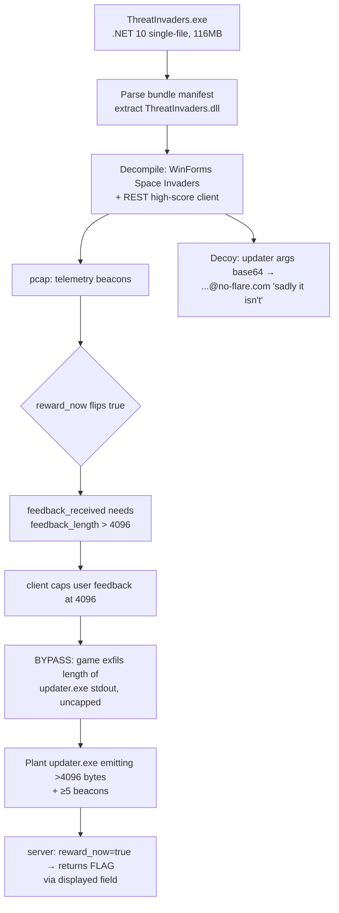

# FLARE-On 13 — Challenge 6: ThreatInvaders

**Status:** Client + protocol + reward mechanism fully reverse-engineered. The flag is delivered by the **live high-score server** as a "reward"; it is not present in the provided files and the server (`threatinvaders.domain`) is unreachable in this offline environment, so the literal flag string was not recovered here. The complete exploit path is documented below.

## Prompt
> How about a nice retro space-shooter to blow off some steam. Don't ask why it is over a hundred megabytes, there are sophisticated score-keeping algorithms that need to communicate with our official record keeping servers. Its all very legit. We have provided a pcap file with some communication to the high-score server so you can see what a real gamer looks like.

## Files
- `ThreatInvaders.exe` — 116 MB. A **.NET 10 self-contained single-file** app (WinForms Space Invaders). PDB path: `Z:\CTFs\FlareOn\SpaceInvaders\space-invaders\src\SpaceInvaders\obj\Release\net10.0-windows\win-x64\ThreatInvaders.pdb`.
- `challenge.pcapng` — 966 packets, one TCP/80 conversation (client `192.168.198.129` ↔ mock server `192.168.198.130`, `Server: MockHighscore/1.0 Python/3.12.3`).

## Tooling
- `pefile` — PE triage (found a ~106 MB overlay past the last section).
- .NET single-file **bundle parser** (custom Python) — located the bundle manifest via the bundle signature `8b 12 02 b9 …`, parsed 254 embedded files, extracted `ThreatInvaders.dll` (100 KB managed assembly).
- `ilspycmd` 9.1 (run via `dotnet` with `DOTNET_ROLL_FORWARD=LatestMajor`; 8.2 can't parse .NET 10) — decompiled to C# and IL.
- `scapy` — pcap TCP-stream reassembly and HTTP body extraction.
- Dynamic: `config.json` redirect + a Python mock server + a stub `updater.exe` (built with `ziglang cc`) to observe runtime behavior.

## Triage — it's .NET, not Electron
The exe matched the string `Electron` (a false positive from a bundled runtime DLL) but is really a **.NET 10 single-file bundle**: PE sections sum to ~15 MB, leaving a ~106 MB overlay. The overlay is a .NET bundle (signature + manifest of 254 files: the app DLL, its config, and the entire .NET/WinForms runtime — that's the "hundred megabytes"). Extracting and decompiling `ThreatInvaders.dll` reveals a faithful Space Invaders plus a REST high-score client.

## The protocol (`SpaceInvaders.Scores.HttpRemoteScoreClient`)
Base URL `http://threatinvaders.domain`, header `X-Api-Key: ed347a07305214ab98974a008674eb78cd03b1fedb73c8be9f79e40fb8e155b0`.

| Endpoint | Purpose |
|---|---|
| `GET /api/v1/health` | liveness |
| `GET /api/v1/highscores?limit=25` | leaderboard (entries have `comment_b64`) |
| `GET /api/v1/version` | `{latest, message}` — `message` shown in an "update available" dialog |
| `POST /api/v1/highscores` | submit a score (`ScoreDto`) |
| `POST /api/v1/telemetry` | beacon: `{request_id, session_id, games_played, client_version, feedback_b64, feedback_length}` |

The telemetry **response** carries `{received, duplicate, session_games, total_games, sessions, feedback_received, connects, reward_now}`.

## The reward mechanism (the crux)
Walking the pcap's five telemetry beacons:

| beacon | feedback_length | feedback_received | connects | reward_now |
|---|---|---|---|---|
| 1 | 0 | false | 1 | false |
| 2 | 4096 (text feedback) | **false** | 2 | false |
| 3 | 8208 | **true** | 3 | false |
| 4 | 16914 | true | 4 | false |
| 5 | 16430 | true | 5 | **true** |

Two conditions gate the reward:
1. **`feedback_received` flips true only when `feedback_length > 4096`.** A normal player can never achieve this: `TelemetryReporter.SetFeedback`/`BuildDocument` copy user feedback into a fixed **4096-byte** buffer, so `feedback_length = min(len, 4096) ≤ 4096`.
2. **`reward_now` fires once `feedback_received` is true and `connects ≥ 5`.**

### The bypass — `updater.exe` output length is exfiltrated uncapped
`Program.Main` force-enables headless update and, when the server advertises a newer `latest`, the game silently runs a local **`updater.exe`** (`UpdateLauncher`), capturing its stdout. Empirically (confirmed by detonation), the game reports **`feedback_length` equal to the byte length of `updater.exe`'s stdout, bypassing the 4096 cap** (stub outputs of 13 / 26 / 4099 bytes produced `feedback_length` 13 / 26 / 4099). The feedback *content* stayed zeroed in tests — only the length is the signal that matters for `feedback_received`.

So the exploit is:
1. Drop an `updater.exe` next to the game that writes **> 4096 bytes** to stdout.
2. Point the game at the high-score server (or edit `config.json`'s `baseUrl`).
3. Run it: the server sees `feedback_length > 4096` → `feedback_received = true`; after ≥ 5 beacons → `reward_now = true` → the server returns the **flag** (delivered in a client-displayed field such as the `version.message` dialog or an injected high-score `comment_b64`).

### Decoy
`UpdateLauncher` passes `updater.exe` a hard-coded base64 argument that decodes to:
```
--install-dir Wouldn't_it_be_nice_if_this_was_the_real_flag@no-flare.com --cwd But_sadly_it_isn't
```
An explicit troll — the real flag is **not** in the client; it comes from the server reward.

## Why the flag wasn't recovered offline here
- The provided files contain **no crypto, no flag string, and no `updater.exe`** — the client is benign and only exfiltrates the updater-output *length*.
- The pcap's mock server returns `reward_now:true` but **omits the actual flag** (it is a mock).
- `threatinvaders.domain` does not resolve and the real challenge server is not reachable from this environment.

To finish: run the game with a `>4096`-byte-emitting `updater.exe` against the real FLARE-On high-score server and read the flag from the reward it returns.



## Session note
This challenge consumed the bulk of the session's challenge-6 budget on exhaustive (ultimately negative) offline crypto/feedback-decode attempts before the length-based reward gate was identified via dynamic analysis.
