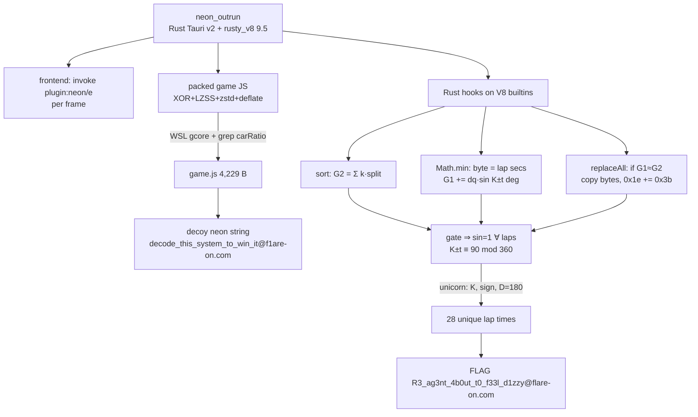

# FLARE-On 13 — Challenge 9: NeonOutRun

**Status:** ✅ Solved (attempt 2). The flag was accepted by the platform. Attempt 1's `decode_this_system_to_win_it@flare-on.com` is the decoy and was rejected.

**Flag:** `R3_ag3nt_4b0ut_t0_f33l_d1zzy@flare-on.com`

## Prompt
> Congratulations on surviving to the final phase of the experiment, where we've wired your central nervous system directly into a 28-lap synthwave racing simulator. You are welcome to drive to the finish line like an obedient little test monkey, though we both know the freedom promised at the end of the highway is a cruel statistical mirage. Rip apart the engine and bend the simulation's physics to your will, or spend the rest of your natural life doing laps in our neon hamster wheel.
>
> *note: upon completing this challenge, the "victory" screen will unlock as a hidden next stage dummy challenge.*

## TL;DR
`neon_outrun` is a stripped x86-64 ELF: a **Rust Tauri v2** game (wry/webkitgtk) with an embedded **V8 9.5.172.19** (`rusty_v8 0.32.1`).

1. The web frontend only draws the game. Each frame it calls `plugin:neon|e`, which runs a hidden 4 KB **game script inside the embedded V8**.
2. The script's finish screen (the "victory" screen from the note) shows a **decoy**: `decode_this_system_to_win_it@f1are-on.com`.
3. The Rust host **hooks three V8 builtins**: `Array.sort`, `Math.min` and `String.replaceAll`.
   - `Math.min` is called once per lap with the lap time. Its hook takes the **lap time in whole seconds as one flag byte**.
   - It also adds to an accumulator: G1 += dqᵢ·sin((Kᵢ ± tᵢ)°).
   - At the finish, `replaceAll` swaps the flag bytes into the string, but only if G1 equals G2 = Σdqᵢ.
4. The dqᵢ are randomly scaled, so the gate only passes when **every** sin is 1: (Kᵢ ± tᵢ) ≡ 90 (mod 360). Each lap has exactly one solution in 0..255, and the 28 solutions spell the flag.

The "statistical mirage" is that the finish line is real, but the only winning run needs 28 laps of 82 s, 51 s, 95 s, … each to the exact second.

## Method
I followed the playbook from [mahaloz/ilio-mini `skills/`](https://github.com/mahaloz/ilio-mini/tree/main/skills), analysed remotely without cloning.
- **`flareon`:** recon → find the check → pull out the constants → cheapest solve (Python, then z3, then emulation) → verify. Flags are usually decrypted at runtime, so capture them rather than reversing everything.
- **`explore-alternatives`:** when stuck or after a wrong answer, switch to a different line of attack (dynamic, static deep-dive, formats, math, re-read the prompt).
- **`windows-dynamic`:** adapted here as WSL Ubuntu + WSLg + gdb/gcore instead of wine.

In practice:
- **Recon (static):** it's a Rust/Tauri/V8 binary.
- **Dynamic:** ran it in WSL and read the game script out of a memory dump.
- **Static deep-dive:** after the wrong submission, reversed the Rust builtin hooks.
- **Math:** turned the gate into one equation per lap.
- **Emulation:** unicorn pulled the per-lap constants out of the obfuscated helpers.

## Layer 1 — recon
- It's a 21 MB PIE, stripped. Byte greps show `rustc`, `webkit`/`gtk`, `__TAURI`, `rusty_v8-0.32.1` and V8 `9.5.172.19`. The 5 `\0asm` hits are false positives in `.text`.
- The Tauri asset table holds 5 brotli-compressed files: `index.html`, `car.png`, `lap.png`, `obstacle.png` and `tree.png`.
- `index.html` sends `{up, down, left, right, restart, bounds}` to `invoke('plugin:neon|e', …)` and renders the `{state, obstacles, laps}` it gets back. The flag area is `#neon-screen`, which shows `state.neon` once `state.finished` is set.
- Game keys such as `carRatio` and `totalLaps` don't appear anywhere in the file, so the game script is packed. Attempt 1 found the packing: XOR `d35a` + LZSS + zstd + raw deflate, decoded at runtime.

## Layer 2 — the game script (dynamic)
The binary runs in WSL Ubuntu (libwebkit2gtk-4.1 plus WSLg). To get the script out:
1. Set `ptrace_scope=0`.
2. Launch the game detached and `gcore` it after about 12 s. The dump is ~15 GB because of the V8 reservation.
3. Grep the dump for `carRatio`.

The plaintext script (4,229 B) is in the V8 heap and is saved as `game.js`.

- **Physics:**
  - Each frame: speed += 0.5 while holding up, then speed ×= 0.96.
  - There are 28 randomly placed lap lines, the last at y = −100000.
  - Obstacles take the lap-line gaps into account.
  - You crash if you leave `input.bounds` or come within 32 px of an obstacle. Both checks use the bounds the client sends.
- **Lap bookkeeping:** on each lap line the script calls `state.bestLapSeconds = Math.min(state.bestLapSeconds, lapSecs)`, then appends `messages[⌊i/2⌋][map[i]]` to `neon`.
- **Finish:** `neon += String.fromCharCode(64,102,49,97,114,101,45,111,110,46,99,111,109)` (= `@f1are-on.com`, with a digit one), then `state.neon = neon.replaceAll(" ","_")`.

`solve.py` reproduces the decoy, `decode_this_system_to_win_it@f1are-on.com`. The JS never uses the lap times beyond display, which is the hint that the host is watching `Math.min`.

## Layer 3 — the Rust builtin hooks ("rip apart the engine")
The first lead was a unique `add byte ptr [rcx+0x1e], 0x3b` at `0x67ea68`. Index 0x1e is the `1` in `f1are`, and `'1'+0x3b = 'l'`. The function containing it reads two global f64 values, G1 @ `0x1438590` and G2 @ `0x1438580`. Following the xrefs to them leads to the other two hooks. All three are control-flow-flattened, and every constant is built through bswap/rol/add chains.

| Hook | Function | What it does |
|---|---|---|
| `Array.sort` (on `splits.sort`, in `generateLaps`) | `0x67deb2` | Draws k = round(1 + u·65534), with u from a PCG64-style LCG (`0x5851f42d4c957f2d`, `0x14057b7ef767814f`). Multiplies each of the 28 splits by k and **queues** them (dqᵢ). Sets **G2 = −0.0 + Σdqᵢ** and resets G1 and the flag vector. |
| `Math.min` (lap time is arg 1) | `0x67eb83` | Pops dqᵢ and increments the lap index i. t = trunc(lapSecs); it rejects the lap unless t is a whole number in [0, 255], then **pushes t as a flag byte**. Gets (Kᵢ, sᵢ) = `0x68003e(0x67f9d8(i, 90))`, where 90 comes from a flattened byte chain. The angle is θ = (π/180)·(Kᵢ + sᵢ·t) reduced mod 2π with `round`, and D = 180 is also folded from chains. Then **G1 += dqᵢ·sin θ**, with sin as a 16-term Taylor series (`0x687cff` → `0x687d80`). |
| `String.replaceAll` | `0x67e81e` | Gate: \|G1\| > 1e-6, \|G2\| > 1e-6 and \|G1 − G2\| < 1e-6. If it passes, it copies the flag vector over the start of the result string, then `s[0x1e] += 0x3b`. |

Helper imports resolved through RELATIVE relocations:
- `0x13b2840` = `round`
- `0x13b2930` = `trunc`
- `0x13b2a00` = a 128-bit division helper

### Why the gate pins every lap
G1 − G2 = Σ dqᵢ·(sin θᵢ − 1). Each term is ≤ 0, and every dqᵢ is a random multiple of a nonzero split. So the only reliable way to reach |G1 − G2| < 1e-6 is sin θᵢ = 1 on every lap:

```
Kᵢ + sᵢ·tᵢ ≡ 90 (mod 360),   tᵢ ∈ [0, 255]
```

## Layer 4 — solving
`emu.py` maps the ELF's LOAD segments into **unicorn**, applies the RELATIVE relocations, and then:
- runs the pure byte chain (`0x67ed5b..0x67eec7`) → **90**;
- runs the 64-bit chains (`0x67ef9f..0x67f8b8`) → **D = 180** and **16** Taylor terms;
- calls `0x67f9d8(i, 90)` and then `0x68003e(·)` for i = 0..27 → (Kᵢ, sᵢ), for example (168236812, −), (−352168521, +), …

`solve2.py` solves each congruence. Every lap has **exactly one** tᵢ, and all 28 are printable:

```
82 51 95 97 103 51 110 116 95 52 98 48 117 116 95 116 48 95 102 51 51 108 95 100 49 122 122 121
R  3  _  a  g   3  n   t   _  4  b  0  u   t   _  t   0  _  f   3  3  l   _  d   1  z   z   y
```

That gives 28 bytes followed by `@f1are-on.com`, and `[0x1e] += 0x3b` turns it into `@flare-on.com`: **`R3_ag3nt_4b0ut_t0_f33l_d1zzy@flare-on.com`**.



## Reproduce
```bash
cd 9-neonoutrun-attempt-2
"C:/Program Files/7-Zip/7z.exe" x -pflare 9-NeonOutRun.7z
python emu.py      # -> params.json: 90, D=180.0, 16 terms, 28 × (K, sign)
python solve2.py   # -> R3_ag3nt_4b0ut_t0_f33l_d1zzy@flare-on.com
```
- `emu.py` needs `lief` and `unicorn`. It works on the binary alone; no WSL is needed.
- `solve.py` (the decoy) needs `game.js`. To regenerate it, run `dump.sh` in WSL and grep the core for `carRatio`.

## First attempt — what went wrong
Attempt 1 (`9-neonoutrun/`, Opus 5.5 → 4.8, ~12.9 h, ~1.0 M output tokens) did most of the hard engineering:
- got the game running in WSL;
- recovered the four-stage script packing;
- identified all three builtin hooks and the `f1are → flare` patch.

It then submitted the decoy. Two mistakes:
- **It misread the angle as independent of the byte.** It modeled the `Math.min` weight as sin(F(lap)°) with F not depending on the lap time. That made G1 == G2 look "unsatisfiable", so it concluded the gate was the mirage and the JS string was the answer. In fact the angle is **Kᵢ ± t**, and t *is* the flag byte.
- **It ignored the prompt's note.** "The victory screen will unlock as a hidden next stage *dummy* challenge" says the neon/victory text is the dummy. The patch it found only fixes the decoy's domain; the gate decides whether the real bytes replace it.

Attempt 2 also began by trusting attempt 1's memory note and repeated the decoy, which was rejected. After re-reading the note, it traced the gate's data flow from `replaceAll` → G1/G2 → the two writers. The key checks were:
1. **Where** each operand of the gate is written.
2. **What** each operand depends on: the popped dq, the lap byte t, and the per-lap constants.
3. Whether the gate is **satisfiable per term**, rather than as a whole.

**Lesson:** when a gate looks impossible, check which inputs you assumed were constant. And don't take a flag from an old note as verified until the platform has accepted it.

## Tooling used
- WSL Ubuntu 26.04 (libwebkit2gtk-4.1, WSLg), `gdb`/`gcore` and `strace` for the dynamic stage. Commands that use `$` go in script files, because Git Bash expands `$` inside `wsl -- bash -c`.
- Python: `lief` (segments and relocations), `capstone` (`cdis.py`, a function disassembler using `.eh_frame_hdr` bounds; `xref.py`, a brute-force RIP-relative xref finder), `unicorn` (`emu.py`) and `brotli`.
- Ghidra 12.1.2 headless was started but not needed. Auto-analysis of the 21 MB Rust binary took more than 30 minutes, while `.eh_frame` plus capstone gave function bounds immediately.
