# FLARE-On 13 (2026) — Solutions 1–9

Write-ups for the nine FLARE-On 13 challenges, solved with Claude Code on a Windows 11 host. Each challenge has its own detailed page; this index summarizes results and the session metrics. All nine challenges are fully solved (flags recovered offline).

## Challenge index

| # | Challenge | Category | Flag | Model(s) | Approx. time |
|---|-----------|----------|------|----------|--------------|
| 1 | [flarecaptcha](01-flarecaptcha.md) | JS deobfuscation | `triskaidekaphobia@flare-on.com` | Opus 5.5 | ~24 s |
| 2 | [GhostStream](02-ghoststream.md) | WIM / IPC / modified RC4 | `y0u_kn0w_n07h1n6_j0n_5n0w@flare-on.com` | Opus 5.5 | ~8.3 min |
| 3 | [flareon13.doc](03-flareon13-doc.md) | Polyglot (COM/ISO/ZIP-Reduce/PDF/Mach-O) | `Ju$7_4_l177l3_7r34$ur3_HUN7@flare-on.com` | Opus 5.5 | ~14.5 min |
| 4 | [ToxicMiner](04-toxicminer.md) | cpuminer trojan / SHA-256d + RC4 brute | `cpu_m3lt3d_4nd_all_i_g0t_w4s_th1s_fl4g@flare-on.com` | Opus 5.5 + 4.8 | ~78.6 min |
| 5 | [catthief](05-catthief.md) | Rust implant / custom Huffman + RC4 | `th3r3_b3_tr34sure_1n_th4t_pc4p@flare-on.com` | Opus 4.8 | ~537 min* |
| 6 | [ThreatInvaders](06-threatinvaders.md) | .NET 10 modified-runtime / detour hooks / PCG-XOR exfil | `wh4t_4_l0ng_str4ng3_tr1p_1ts_b33n@flare-on.com` | Opus 4.8 | — |
| 7 | [FlareCalc](07-flarecalc.md) | Cert-embedded x64 implant / custom packer VM / XTEA labyrinth | `t3mplat3s_asn_and_j1t_0h_my@flare-on.com` | Opus 4.8 | — |
| 8 | [crux](08-crux.md) | garble Go WASM extension / AES-CBC / Pratt primality certificate | `Pr4tt_Pr1M4lItY_C3rt5_4nd_Wa4aA4aAA4aAA4a4a5M@flare-on.com` | Opus 5.5 (attempt 2) | ~19 min† |
| 9 | [NeonOutRun](09-neonoutrun.md) | Rust Tauri + embedded V8 / hooked JS builtins / lap-time sine gate | `R3_ag3nt_4b0ut_t0_f33l_d1zzy@flare-on.com` | Opus 5.5 (attempt 2) | ~50 min§ |

\* Challenge 5 spans two sessions; the metric is the first session only.
† Challenge 8 took two attempts. The ~19 min is the fresh second session that solved it; the first attempt (Opus 4.8, ~24 h, unsolved) is listed separately below.
§ Challenge 9 took two attempts. Attempt 1 (Opus 5.5 → 4.8, ~12.9 h) submitted the decoy `decode_this_system_to_win_it@flare-on.com`, which was rejected. The ~50 min is the second session, including its own rejected resubmission of that decoy.

## Overview

```mermaid
flowchart LR
    C1[1. flarecaptcha<br/>JS pun: fear of 13] --> C2[2. GhostStream<br/>WIM + named-pipe + RC4 twist]
    C2 --> C3[3. flareon13.doc<br/>5-format polyglot hunt]
    C3 --> C4[4. ToxicMiner<br/>volume-serial SHA256d + RC4 brute]
    C4 --> C5[5. catthief<br/>custom Huffman + RC4 over pcap]
    C5 --> C6[6. ThreatInvaders<br/>modified .NET runtime + PCG-XOR exfil]
    C6 --> C7[7. FlareCalc<br/>cert-embedded implant + XTEA labyrinth]
    C7 --> C8[8. crux<br/>garble Go WASM + Pratt certificate]
    C8 --> C9[9. NeonOutRun<br/>V8 builtin hooks + lap-time sine gate]
    C9 --> DONE([9/9 flags recovered offline])
```

## Common techniques across the set
- **Ghidra headless** decompilation driven by small `GhidraScript` helpers (`DecompAll.java`, `DecompOne.java`).
- **Emulation over execution**: Unicorn for the 16-bit COM stage (ch3); an **image-mapping harness** that calls the sample's own crypto functions (ch4).
- **Dynamic instrumentation with Frida** as an oracle when static RE stalled (ch5 compression oracle; ch2 pipe sniffing).
- **RC4 everywhere** — standard, modified-step, and identity-seeded variants — plus a bespoke canonical-Huffman codec.
- **WASM binary rewriting** (ch8): entry/exit hooks spliced into a garble-stripped Go WASM via a hijacked existing import, plus a flat state-machine decompiler, because wabt output blew up to ~1.8 GB.
- **Hooked-runtime challenges** (ch6 .NET, ch9 V8): the sample's own interpreter or runtime is modified, so the visible logic (managed IL or game JS) is only a decoy layer. In ch9 the flag is the 28 lap times, pinned by a sin((K ± t)°) = 1 gate in the Rust hooks and solved by unicorn-emulating the obfuscated helpers.
- **Memory dumping** (ch9): `gcore` a running WSL/WSLg process and grep the V8 heap for the decrypted script.
- **Safe detonation** only when required: `7z e -so` into memory + DOS-stub byte patch to dodge Defender.

## Session Metrics

Measured from the Claude Code transcripts (`8ad03a1c-…jsonl` for 1–7 and crux attempt 1; `98b30fb5-…jsonl` for crux attempt 2; `a7403356-…jsonl` + 1 subagent for NeonOutRun attempt 1; `a9fe5c96-…jsonl` for NeonOutRun attempt 2). Assistant messages are de-duplicated by message id; raw numbers are in `session_stats.json`. "Cache-read" tokens are prompt-cache reads (billed at a large discount); "output" tokens are model generation.

| Challenge | Output tokens | Cache-read tokens | Model(s) (turns) | Wall-clock |
|---|---:|---:|---|---:|
| 1 flarecaptcha | 3,080 | 324,235 | Opus 5.5 (8) | ~24 s |
| 2 GhostStream | 107,968 | 10,771,008 | Opus 5.5 (99) | ~8.3 min |
| 3 flareon13.doc | 108,133 | 28,134,581 | Opus 5.5 (134) | ~14.5 min |
| 4 ToxicMiner | 203,806 | 39,017,330 | Opus 5.5 (39) + 4.8 (91) | ~78.6 min |
| 5 catthief* | ~2,034,480 | ~379,101,610 | Opus 4.8 (708) | ~537 min |
| 8 crux — attempt 1 (unsolved) | ~4,322,864 | ~464,348,235 | Opus 4.8 (1,581) + Fable 5 (6) | ~23.8 h‡ |
| 8 crux — attempt 2 (solved) | 46,607 | 6,260,769 | Opus 5.5 (68) | ~18.7 min |
| 9 NeonOutRun — attempt 1 (decoy, rejected) | 1,019,290 | 150,010,266 | Opus 5.5 (121) + 4.8 (352) | ~12.9 h |
| 9 NeonOutRun — attempt 2 (solved) | 51,065 | 8,811,524 | Opus 5.5 (78) | ~50 min |
| **Total (1–5, 8, 9)** | **~7,897,293** | **~1,086,778,958** | Opus 5.5 / 4.8 / Fable 5 | **~48.5 h** |

\* Challenge 5 numbers are the first session only; the solve completed in a follow-up session (not included). Challenges 6–7 were not metered.
‡ Wall-clock span from the ch7 commit to the last attempt-1 message, including idle gaps and parallel subagents; token counts include subagents.

**Observations**
- Difficulty (and token spend) climbs sharply: challenge 5 alone is ~83% of the output tokens for 1–5.
- **Challenge 8 shows how much the approach matters.** Attempt 1 spent ~4.3 M output tokens chasing a wrong model: a 32–47-byte message and an "S-expression evaluator". Attempt 2 started fresh, traced concrete arguments and bigint values, and built a tiny valid input first (the certificate for 3). That exposed the target prime and solved the challenge with **~1 %** of the tokens (46.6 K output) in ~19 min.
- **Challenge 9 failed on a misread dependency, not on missing engineering.** Attempt 1 recovered the script packing and all three builtin hooks. But it modeled the gate's angle as not depending on the lap-time byte, declared the gate an unsatisfiable "mirage", and submitted the decoy. Attempt 2 re-read the prompt's "victory screen = dummy" note after that decoy was rejected again. It then traced what each gate operand depends on and found the angle is K ± t with t the flag byte. With ~5 % of attempt 1's output tokens, that gave 28 unique lap times.
- The model was switched **Opus 5.5 → Opus 4.8** during challenge 4 and stayed on 4.8 for challenge 5.
- Heavy cache-read counts reflect long single-challenge sessions where the growing context is re-read cheaply each turn.

*All figures approximate.*
