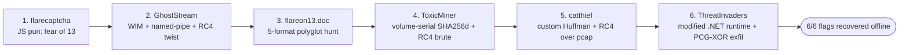

# FLARE-On 13 (2026) — Solutions 1–6

Write-ups for the first six FLARE-On 13 challenges, solved with Claude Code on a Windows 11 host. Each challenge has its own detailed page; this index summarizes results and the session metrics. All six challenges are fully solved (flags recovered offline).

## Challenge index

| # | Challenge | Category | Flag | Model(s) | Approx. time |
|---|-----------|----------|------|----------|--------------|
| 1 | [flarecaptcha](01-flarecaptcha.md) | JS deobfuscation | `triskaidekaphobia@flare-on.com` | Opus 5.5 | ~24 s |
| 2 | [GhostStream](02-ghoststream.md) | WIM / IPC / modified RC4 | `y0u_kn0w_n07h1n6_j0n_5n0w@flare-on.com` | Opus 5.5 | ~8.3 min |
| 3 | [flareon13.doc](03-flareon13-doc.md) | Polyglot (COM/ISO/ZIP-Reduce/PDF/Mach-O) | `Ju$7_4_l177l3_7r34$ur3_HUN7@flare-on.com` | Opus 5.5 | ~14.5 min |
| 4 | [ToxicMiner](04-toxicminer.md) | cpuminer trojan / SHA-256d + RC4 brute | `cpu_m3lt3d_4nd_all_i_g0t_w4s_th1s_fl4g@flare-on.com` | Opus 5.5 + 4.8 | ~78.6 min |
| 5 | [catthief](05-catthief.md) | Rust implant / custom Huffman + RC4 | `th3r3_b3_tr34sure_1n_th4t_pc4p@flare-on.com` | Opus 4.8 | ~537 min* |
| 6 | [ThreatInvaders](06-threatinvaders.md) | .NET 10 modified-runtime / detour hooks / PCG-XOR exfil | `wh4t_4_l0ng_str4ng3_tr1p_1ts_b33n@flare-on.com` | Opus 4.8 | — |

\* Challenge 5 spans two sessions; the metric is the first session only.

## Overview

## Common techniques across the set
- **Ghidra headless** decompilation driven by small `GhidraScript` helpers (`DecompAll.java`, `DecompOne.java`).
- **Emulation over execution**: Unicorn for the 16-bit COM stage (ch3); an **image-mapping harness** that calls the sample's own crypto functions (ch4).
- **Dynamic instrumentation with Frida** as an oracle when static RE stalled (ch5 compression oracle; ch2 pipe sniffing).
- **RC4 everywhere** — standard, modified-step, and identity-seeded variants — plus a bespoke canonical-Huffman codec.
- **Safe detonation** only when required: `7z e -so` into memory + DOS-stub byte patch to dodge Defender.

## Session Metrics

Measured from the Claude Code transcript (`8ad03a1c-…jsonl`). "Cache-read" tokens are prompt-cache reads (billed at a large discount); "output" tokens are model generation.

| Challenge | Output tokens | Cache-read tokens | Model(s) (turns) | Wall-clock |
|---|---:|---:|---|---:|
| 1 flarecaptcha | 3,080 | 324,235 | Opus 5.5 (8) | ~24 s |
| 2 GhostStream | 107,968 | 10,771,008 | Opus 5.5 (99) | ~8.3 min |
| 3 flareon13.doc | 108,133 | 28,134,581 | Opus 5.5 (134) | ~14.5 min |
| 4 ToxicMiner | 203,806 | 39,017,330 | Opus 5.5 (39) + 4.8 (91) | ~78.6 min |
| 5 catthief* | ~2,034,480 | ~379,101,610 | Opus 4.8 (708) | ~537 min |
| **Total** | **~2,457,467** | **~457,348,164** | Opus 5.5 / 4.8 | **~10.7 h** |

\* Challenge 5 numbers are the first session only; the solve completed in a follow-up session (not included).

**Observations**
- Difficulty (and token spend) climbs sharply: challenge 5 alone is ~83% of all output tokens.
- The model was switched **Opus 5.5 → Opus 4.8** during challenge 4 and stayed on 4.8 for challenge 5.
- Heavy cache-read counts reflect long single-challenge sessions where the growing context is re-read cheaply each turn.

*All figures approximate.*
